# ⚡ Autonomous Job Scout, Resume Tailor & Application System

<p align="center">
  
  
  
  
  
  
</p>

> **Beat the applicant rush.** Discover newly posted tech requisitions in real time across **30+ career platforms**, tailor single-column Word ATS resumes with **zero hallucination**, and autonomously apply through your **real authenticated browser session**.

---

## 📑 Table of Contents

- [🎯 Overview & Why It Exists](#-overview--why-it-exists)
- [🏗️ System Architecture](#️-system-architecture)
- [✨ Core Capabilities](#-core-capabilities)
  - [🌐 30+ Supported Platforms & Extensible Registry](#-30-supported-platforms--extensible-registry)
  - [🔥 24-Hour Freshness Prioritization](#-24-hour-freshness-prioritization)
  - [🔄 Refresh Unseen Feed & Live Sweeping](#-refresh-unseen-feed--live-sweeping)
  - [🛡️ Anti-Ghosting & Requisition Purge](#️-anti-ghosting--requisition-purge)
  - [📄 Zero-Fabrication Resume Tailoring & Word ATS Editor](#-zero-fabrication-resume-tailoring--word-ats-editor)
  - [⚡ Stealth Browser Auto-Apply (CDP Session Reuse)](#-stealth-browser-auto-apply-cdp-session-reuse)
  - [🧠 Dynamic LLM Screening Question Solver](#-dynamic-llm-screening-question-solver)
  - [🚨 Human-In-The-Loop (HITL) Alerting](#-human-in-the-loop-hitl-alerting)
- [🤖 Supported Open-Source & Cloud LLM Baselines](#-supported-open-source--cloud-llm-baselines)
- [🚀 Quickstart & Installation](#-quickstart--installation)
  - [1. Clone & Environment Setup](#1-clone--environment-setup)
  - [2. Configure Environment (`.env`)](#2-configure-environment-env)
  - [3. Configure Candidate Profile Ground Truth](#3-configure-candidate-profile-ground-truth)
  - [4. Add Base Resume & ATS Template](#4-add-base-resume--ats-template)
- [💻 How to Start & Apply](#-how-to-start--apply)
  - [Option A: Web Dashboard (Recommended)](#option-a-web-dashboard-recommended)
  - [Option B: Rich Command-Line Interface (CLI)](#option-b-rich-command-line-interface-cli)
  - [Option C: 24/7 Autonomous Daemon](#option-c-247-autonomous-daemon)
  - [Option D: Model Context Protocol (FastMCP)](#option-d-model-context-protocol-fastmcp)
- [🛡️ Stealth Chrome Setup (Zero Bot Bans)](#️-stealth-chrome-setup-zero-bot-bans)
- [📁 Project Layout](#-project-layout)
- [🧪 Running the Test Suite](#-running-the-test-suite)
- [🔒 Privacy, Security & Responsible Use](#-privacy-security--responsible-use)
- [🤝 Contributing](#-contributing)
- [📜 License](#-license)

---

## 🎯 Overview & Why It Exists

In modern hiring, **the first 2 to 4 hours of a job posting determine interview callback rates**. High-demand positions on LinkedIn, Indeed, Wellfound, and direct ATS portals receive hundreds of applicants within hours. Applicants who apply days later are often buried at the bottom of the recruiter's Applicant Tracking System (ATS) or filtered by applicant caps.

### Why Traditional Application Bots Fail:
1. **Aggressive Bot Detection**: Cloudflare, DataDome, and platform anti-automation ban accounts spawning isolated Puppeteer/Selenium test instances.
2. **Form Variation Breakdowns**: Every ATS (Greenhouse, Lever, Ashby, Workday) and platform has custom questions (*"How many years of FastAPI experience?", "What is your expected CTC?", "Describe a production outage"*). Rigid rule-based scripts break on step 1.
3. **Resume Hallucinations**: Generic AI wrapper bots fabricate experience or deliver generic PDF exports that fail ATS parsers.
4. **Ghost & Stale Postings**: Job seekers waste hours submitting applications to expired requisitions, evergreen pools, and placeholder listings.

### The Solution:
This project decouples high-speed anonymous discovery from authenticated dispatch, incorporates a strict **24-hour freshness engine**, integrates **anti-ghosting verification**, tailors **official OpenXML ATS resumes with zero fabrication**, and applies through your **real Chrome browser via Chrome DevTools Protocol (CDP)**.

---

## 🏗️ System Architecture

```mermaid
flowchart TD
    subgraph Discovery ["1. Real-Time Discovery Scout (30+ Sources)"]
        D1[Direct ATS APIs: Greenhouse, Lever, Ashby]
        D2[Tech Boards: LinkedIn, Indeed, Wellfound, RemoteOK]
        D3[India Tech: Naukri, Hirist, Devfolio, Internshala]
        D4[Niche AI: Sprout, Beep, AI-Job.net, ML-Jobs]
        D5[Dynamic Custom RSS & JSON Endpoints]
        D1 & D2 & D3 & D4 & D5 --> AGG[Aggregator & Deduplication Engine]
        AGG --> GHOST{Ghost Job Detector}
        GHOST -->|Reject: Dead / Fake / Stale| PURGE[(Purged)]
        GHOST -->|Accept: Valid Requisition| DB[(SQLite Database: mcp_jobs.db)]
    end

    subgraph Prioritization ["2. 24H Freshness & Semantic Evaluation"]
        DB --> FRESH[24-Hour Freshness Tier Engine]
        FRESH -->|Age <= 24h| TIER1[Tier 1: High Priority Top Place]
        FRESH -->|Age > 24h| TIER2[Tier 2: Standard Pool]
        TIER1 & TIER2 --> FIT[Profile Manager & Match Scorer]
        FIT --> QUALIFIED[Qualified Queue]
    end

    subgraph Tailoring ["3. Zero-Fabrication Resume Tailor Agent"]
        QUALIFIED --> TAILOR[Resume Tailor Agent]
        GROUND[(Candidate Ground Truth: profile.yaml)] --> TAILOR
        TAILOR --> DOCX_RENDER[Native OpenXML Renderer]
        DOCX_RENDER --> WORD_DOC[Custom Word ATS Resume .docx]
        WORD_DOC --> EDITOR[Interactive Web Layout Editor]
    end

    subgraph Dispatcher ["4. Stealth Browser Dispatcher"]
        EDITOR & QUALIFIED --> DISPATCH[Stealth Dispatcher]
        CHROME[Candidate's Real Chrome Session: CDP :9222] --> DISPATCH
        DISPATCH --> SOLVER[Dynamic LLM Screening Solver]
        SOLVER --> HITL_CHECK{Challenge Detected?}
        HITL_CHECK -->|CAPTCHA / 2FA / OTP| HITL[Telegram / Discord Mobile Alert + Audio Chime]
        HITL_CHECK -->|Clean Form| SUBMIT[Attach Tailored .docx & Submit]
        SUBMIT --> AUDIT[(Audit Proof Screenshot & History)]
    end

    subgraph Interfaces ["5. Unified Control Interfaces"]
        WEB[FastAPI / Vanilla JS Web Dashboard :8000] --> Discovery & Prioritization & Tailoring & Dispatcher
        CLI[Rich Command-Line Interface cli.py] --> Discovery & Prioritization & Tailoring & Dispatcher
        MCP[FastMCP Server for Claude / Cursor / IDEs] --> Discovery & Prioritization & Tailoring & Dispatcher
    end
```



---

## ✨ Core Capabilities

### 🌐 30+ Supported Platforms & Extensible Registry
Monitors public APIs, guest syndication feeds, and structured endpoints across:
- **Direct Enterprise ATS**: Greenhouse, Lever, Ashby, Workday.
- **Global Tech Boards**: LinkedIn, Indeed, Wellfound, RemoteOK, Remotive, 4DayWeek, Dev.to, Simplify, Crossover.
- **India Tech Ecosystem**: Naukri (India LPA compensation parsing), Hirist, Internshala, Cutshort, Devfolio (Web3 & builder roles), Unstop, Foundit.
- **Niche AI & ML Boards**: Usesprout (Sprout AI roles), Beep AI, AI-Job.net, AIJobs.ai, ML-Jobs.info, ICrunchData.
- **Extensible Provider Engine**: Add custom RSS feeds, JSON APIs, or drop Python scripts into `discovery/plugins/` with auto-discovery.

### 🔥 24-Hour Freshness Prioritization
- Evaluates true posting age (`posted_at` or `discovered_at`).
- Jobs posted within **$\le 24$ hours** are automatically placed in **first place** by SQLite database queries and API sorting.
- Visual badges (`🔥 Fresh (< 24h)`) and relative time display (`🕒 2h ago`) keep top-priority postings front and center.
- Dedicated dashboard metric card for 1-click filtering of 24h fresh listings.

### 🔄 Refresh Unseen Feed & Live Sweeping
- **`🔄 Refresh New Jobs` Button**: Records viewed job IDs and automatically fetches the next batch of **strictly unseen jobs** without repeating previous listings.
- **`⚡ Live Sweep & Refresh` Button**: Triggers a live multi-platform crawl, deduplicates results, and immediately injects newly discovered unseen jobs into view.
- **Unseen Tracker Bar**: Live display of current view count, total unseen postings remaining in the database, and a `↺ Reset Seen` option.
- **`✨ Load Next 100 Unseen Jobs`**: Infinite-scroll pagination button at the bottom of the feed.

### 🛡️ Anti-Ghosting & Requisition Purge
- Automated **`GhostJobDetector`** identifies dummy employer seeds, placeholder URLs, expired requisitions, and evergreen hiring pools.
- Form filler verifies live requisition health; automatically detects closed/expired postings before attempting input.
- Database clean-up command (`python cli.py purge-ghosts`) purges dead records permanently.

### 📄 Zero-Fabrication Resume Tailoring & Word ATS Editor
- Grounded strictly in your verified candidate profile (`config/profile.yaml`)—**never invents credentials, companies, or degrees**.
- Adapts Summary/Objective, Experience bullet emphases, Projects with `Technologies Used:`, Skill Summary, and Cover Letter for the target job description.
- **Native OpenXML DOCX Renderer** (`core/resume_docx_renderer.py`): Built using Python standard libraries (`zipfile` and `xml.etree.ElementTree`) to produce standard-compliant Word `.docx` resumes with right-aligned tabs, clean margins, and bullet styles.
- **Interactive In-Browser Editor**: 3-tab modal in the Web UI allows real-time field editing, live Word document preview, `.docx` artifact download, and 1-click apply with the customized resume.

### ⚡ Stealth Browser Auto-Apply (CDP Session Reuse)
- Connects to your **existing Google Chrome browser** via Chrome DevTools Protocol (`--remote-debugging-port=9222`).
- Reuses your active tabs, session cookies, and logins (LinkedIn, Indeed, etc.)—**no spamming of new test browser windows**.
- Submits candidate's customized `.docx` resume directly to the target ATS.

### 🧠 Dynamic LLM Screening Question Solver
- Resolves open-ended and closed-ended screening questions dynamically using your structured candidate knowledge base:
  - *"How many years of experience with PostgreSQL?"* $\rightarrow$ Calculates exact years from experience history.
  - *"Are you legally authorized to work in the United States?"* $\rightarrow$ Answers from `work_authorization`.
  - *"Why are you interested in this role?"* $\rightarrow$ Generates concise, role-grounded rationale.

### 🚨 Human-In-The-Loop (HITL) Alerting
- If a security checkpoint (CAPTCHA, 2FA, OTP, or unknown document upload) is encountered:
  - Execution safely pauses.
  - Pings your **Telegram Bot** or **Discord Webhook** with a screenshot and audio alert chime.
  - Gives you 60 seconds to resolve the challenge directly in your visible Chrome window before continuing automatically.

---

## 🤖 Supported Open-Source & Cloud LLM Baselines

The system natively supports structured tool-calling with zero vendor lock-in:

| Provider | Model | Type | Speed | Cost | Best For |
|---|---|---|---|---|---|
| **Google Gemini (Recommended)** | `gemini-2.0-flash` | Cloud | Ultra-Fast | Free Tier Available | 1M+ context window, native tool calling, resume tailoring |
| **Google Gemini** | `gemini-1.5-flash` | Cloud | Fast | Free Tier Available | Reliable fallback, high-accuracy screening question synthesis |
| **Groq** | `llama-3.3-70b-versatile` | Cloud | 300+ tok/s | Free Tier | Lightning-fast screening Q&A & live tailoring |
| **Groq** | `qwen-2.5-32b` | Cloud | 280+ tok/s | Free Tier | High-precision ATS form field mapping |
| **Ollama** | `qwen2.5:14b` or `qwen2.5:7b` | Local | Hardware dependent | 100% Free / Offline | Total privacy, zero internet dependency |
| **Ollama** | `llama3.3:70b` | Local | Hardware dependent | 100% Free / Offline | High-capability local reasoning |
| **DeepSeek** | `deepseek-chat` | Cloud | Fast | Very Low Cost | Complex screening reasoning & cover letters |
| **OpenAI / Anthropic** | `gpt-4o`, `claude-3-5-sonnet` | Cloud | Standard | Paid API | General drop-in fallback |

---

## 🚀 Quickstart & Installation

### 1. Clone & Environment Setup

```bash
# Clone the repository
git clone https://github.com/your-username/autonomous-job-agent.git
cd autonomous-job-agent

# Create a virtual environment
python -m venv venv

# Activate virtual environment
# On Windows (PowerShell):
.\venv\Scripts\Activate.ps1
# On Windows (cmd):
.\venv\Scripts\activate.bat
# On macOS / Linux:
source venv/bin/activate

# Install dependencies
pip install -r requirements.txt

# Install Playwright browser dependencies
playwright install chromium
```

### 2. Configure Environment (`.env`)

Copy `.env.example` to `.env`:

```bash
cp .env.example .env
```

Edit `.env` to select your preferred LLM provider:

```ini
# Option A: Recommended Cloud (Google Gemini API - Generous Free Tier)
LLM_PROVIDER=gemini
LLM_MODEL=gemini-2.0-flash
GEMINI_API_KEY=your_gemini_api_key_here

# Option B: Ultra-Fast Cloud Alternative (Groq Free Tier)
# LLM_PROVIDER=groq
# LLM_MODEL=llama-3.3-70b-versatile
# GROQ_API_KEY=your_groq_api_key_here

# Option C: 100% Local & Free (Ollama)
# LLM_PROVIDER=ollama
# LLM_MODEL=qwen2.5:14b
# OLLAMA_BASE_URL=http://localhost:11434/v1

# Database & Browser Settings
DATABASE_PATH=data/mcp_jobs.db
PLAYWRIGHT_HEADLESS=false
BROWSER_USER_DATA_DIR=data/browser_profile

# Optional Mobile Alerts (Telegram / Discord)
TELEGRAM_BOT_TOKEN=
TELEGRAM_CHAT_ID=
DISCORD_WEBHOOK_URL=
```

### 3. Configure Candidate Profile Ground Truth

Copy the example profile configuration files:

```bash
cp config/profile.example.yaml config/profile.yaml
cp config/candidate_profile.example.json config/candidate_profile.json
cp config/search_preferences.example.json config/search_preferences.json
```

1. Edit **`config/profile.yaml`**: This is your factual ground truth for resume tailoring and fit evaluation (Identity, Work Experience, Education, Projects, Skills, Preferences).
2. Edit **`config/search_preferences.json`**: Set your target role titles, locations, and thresholds:
   ```json
   {
     "target_roles": ["Software Engineer", "AI Engineer", "Full Stack Engineer"],
     "locations": ["Remote", "San Francisco, CA", "Bengaluru"],
     "max_job_age_hours": 24,
     "match_threshold_percent": 70,
     "auto_apply": false
   }
   ```

### 4. Add Base Resume & ATS Template

- Place your standard base PDF resume at: `config/resume.pdf`
- The official single-column Word ATS template is pre-packaged at: `data/templates/mcp-resume-template.docx`

---

## 💻 How to Start & Apply

### Option A: Web Dashboard (Recommended)

Launch the integrated Web UI:

```bash
python cli.py web --port 8000
```

Open your browser at **`http://localhost:8000`**.

```
┌────────────────────────────────────────────────────────────────────────┐
│  ⚡ MCP Job Scout & Application Dashboard                              │
├────────────────────────────────────────────────────────────────────────┤
│  [Discovered Postings]  [Scout Engine]  [Candidate Vault]  [Platforms] │
│                                                                        │
│  [Total: 1,420]  [🔥 Fresh <=24H: 48]  [Qualified >=70%: 312]           │
│                                                                        │
│  Search: [ python ai      ]  Platform: [ All ]  Sort: [ Fresh First ▼] │
│  [🔄 Refresh New Jobs]  [⚡ Live Sweep & Refresh]  [🧹 Clean Ghosts]   │
│                                                                        │
│  Showing 100 postings (48 fresh <=24h) · 240 unseen remaining          │
│                                                                        │
│  94%  Senior AI Engineer · TechNova · Remote [🔥 Fresh (2h ago)]       │
│       [Details]  [✏️ Edit Resume]  [📄 Tailor]  [⚡ Auto-Apply]         │
└────────────────────────────────────────────────────────────────────────┘
```

#### What you can do from the Web Dashboard:
- **Browse & Filter**: Filter by role, company, salary package, platform, and match score.
- **Refresh Unseen Feed**: Click `🔄 Refresh New Jobs` to view the next 100 unseen postings.
- **Live Platform Sweep**: Click `⚡ Live Sweep & Refresh` to trigger an instant multi-platform crawl and display results.
- **Candidate Vault**: View the official Word ATS template, download the `.docx`, or click `✏️ Edit Resume` on any job card to customize bullets and summary before applying.
- **Batch Application**: Click `⚡ Auto-Apply Filtered` or `📋 Pre-fill Filtered` to process qualified applications simultaneously.

---

### Option B: Rich Command-Line Interface (CLI)

The `cli.py` utility gives you full terminal control:

#### 1. Discover New Jobs (Scout Sweep)
```bash
# Run a sweep across all enabled platforms for your target roles:
python cli.py scout

# Run a targeted sweep for a specific platform:
python cli.py scout --platform sprout
python cli.py scout --platform hirist
python cli.py scout --platform ats_direct
```

#### 2. View Discovered Postings
```bash
# List top 20 postings (ranked with fresh <=24h first):
python cli.py list --limit 20

# Filter by platform and minimum match score:
python cli.py list --platform greenhouse --min-score 80
```

#### 3. Evaluate Semantic Match
```bash
python cli.py evaluate <job_id>
```

#### 4. Tailor Resume for a Job
```bash
# Generates tailored .docx and .txt artifacts with zero fabrication:
python cli.py tailor <job_id>
```

#### 5. Apply to a Job
```bash
# Review Mode (Pre-fills application and keeps browser tab open for human inspection):
python cli.py apply <job_id>

# Autonomous Mode (Fills, attaches tailored resume, and submits):
python cli.py apply <job_id> --auto-submit
```

#### 6. Clean Ghost Postings
```bash
# Scan and purge fake employers, placeholder URLs, and expired requisitions:
python cli.py purge-ghosts
```

#### 7. Manage Platforms Dynamically
```bash
# List all active platforms:
python cli.py platform list

# Add a custom RSS job board:
python cli.py platform add --name "remoteok" --type "rss" --url "https://remoteok.com/remote-jobs.rss"

# Toggle or disable a platform:
python cli.py platform toggle indeed --disable
```

#### 8. View Analytics
```bash
python cli.py stats
```

---

### Option C: 24/7 Autonomous Daemon

To run background polling and continuous application continuously:

```bash
python cli.py worker
```
Monitors platforms at the configured polling interval (default: 15 minutes), deduplicates new postings, scores them, and applies to or queues qualified postings.

---

### Option D: Model Context Protocol (FastMCP)

Connect this agent directly into **Claude Desktop**, **Cursor**, or **Antigravity IDE** as an MCP server.

Add to your MCP configuration (e.g., `claude_desktop_config.json`):

```json
{
  "mcpServers": {
    "job-scout": {
      "command": "python",
      "args": ["-m", "mcp_server.server"],
      "cwd": "/path/to/autonomous-job-agent"
    }
  }
}
```

#### Exposed MCP Tools:
- `search_recent_jobs(roles, platform, min_match_score, trigger_live_crawl)`
- `evaluate_job_fit(job_id)`
- `tailor_resume_for_job(job_id)`
- `apply_to_job(job_id, auto_submit)`
- `get_application_status()`
- `get_candidate_profile()`
- `purge_ghost_jobs()`

---

## 🛡️ Stealth Chrome Setup (Zero Bot Bans)

To apply through platforms like LinkedIn, Indeed, or Greenhouse without triggering bot detection, the agent connects directly to your **real Chrome session**:

### 1. Start Chrome with Remote Debugging
Close all open Chrome windows and launch Chrome with the debugging port enabled:

**Windows:**
```powershell
chrome.exe --remote-debugging-port=9222 --user-data-dir="data/browser_profile"
```
*(Or use the built-in helper: `python cli.py chrome --port 9222`)*

**macOS:**
```bash
/Applications/Google\ Chrome.app/Contents/MacOS/Google\ Chrome --remote-debugging-port=9222 --user-data-dir="data/browser_profile"
```

**Linux:**
```bash
google-chrome --remote-debugging-port=9222 --user-data-dir="data/browser_profile"
```

### 2. Log in Once
Log in to your target job portals (LinkedIn, Indeed, etc.) manually in this window. Your session cookies and credentials remain persisted in `data/browser_profile`. The agent will reuse these active tabs seamlessly via CDP.

---

## 📁 Project Layout

```
autonomous-job-agent/
├── applicator/                  # Autonomous application execution engine
│   ├── browser.py               # Playwright stealth browser with CDP reuse
│   ├── form_filler.py           # Intelligent ATS form filler & dead requisition detector
│   ├── hitl.py                  # Human-In-The-Loop alerting (Telegram/Discord)
│   └── screening_solver.py      # LLM-powered screening question answering
├── core/                        # Core system models & services
│   ├── config.py                # Configuration and environment loaders
│   ├── database.py              # SQLite repository with unseen tracking & pagination
│   ├── ghost_job_detector.py    # Anti-ghosting detection heuristics
│   ├── models.py                # Pydantic schemas (JobListing, Profile, Status)
│   ├── profile_manager.py       # Profile evaluation & multi-resume manager
│   ├── resume_docx_renderer.py  # Native standard-library OpenXML Word renderer
│   ├── resume_tailor_agent.py   # Zero-fabrication role tailoring agent
│   └── scoring.py               # 5-factor semantic matching & 24h freshness engine
├── discovery/                   # 30+ Job discovery providers
│   ├── aggregator.py            # Multi-platform sweep coordinator & deduplicator
│   ├── base.py                  # Abstract base class for providers
│   ├── plugins/                 # Drop-in custom python provider plugins
│   └── providers/               # Platform implementations (ATS, LinkedIn, Sprout...)
├── config/                      # Configuration files
│   ├── candidate_profile.example.json
│   ├── profile.example.yaml
│   ├── search_preferences.example.json
│   └── companies.yaml
├── data/
│   └── templates/
│       └── mcp-resume-template.docx # Official Word ATS single-column template
├── mcp_server/                  # Model Context Protocol interface
│   └── server.py                # FastMCP server exposing tools to LLM clients
├── web/                         # Single-page Web UI application
│   ├── server.py                # FastAPI / Starlette backend API routes
│   └── static/                  # Responsive frontend (HTML, CSS, Vanilla JS)
├── tests/                       # Comprehensive unit test suite (72 tests)
├── cli.py                       # Unified command-line interface
├── requirements.txt             # Project dependencies
└── README.md
```

---

## 🧪 Running the Test Suite

The repository includes a comprehensive unit test suite covering 24-hour freshness, anti-ghosting detection, OpenXML Word template rendering, custom resume editing, provider scouting, and API endpoints:

```bash
# Run all unit tests:
python -m unittest discover -s tests -p "test_*.py"

# Or run specific test modules:
python -m unittest tests/test_freshness_priority.py
python -m unittest tests/test_refresh_unseen_jobs.py
python -m unittest tests/test_ghost_job_detector.py
python -m unittest tests/test_resume_template_and_editor.py
```

---

## 🔒 Privacy, Security & Responsible Use

1. **Local-First Architecture**: Your resume, database (`mcp_jobs.db`), browser cookies, and candidate profiles stay exclusively on your local machine.
2. **Zero Fabrication**: The Resume Tailor Agent is hard-constrained to your verified `config/profile.yaml`. It never invents skills, companies, or degrees.
3. **Start in Review Mode**: Keep `auto_apply: false` initially. Review pre-filled forms before enabling autonomous submissions.
4. **Guardrails**: Built-in PII protection, scam detection (application fee / payment detection), and domain safety allow-lists prevent automated interactions with fraudulent postings.

---

## 🤝 Contributing

Contributions, issues, and feature requests are welcome!

1. Fork the repository.
2. Create your feature branch (`git checkout -b feature/new-platform`).
3. Commit your changes (`git commit -m "feat: add new platform provider"`).
4. Run unit tests (`python -m unittest discover -s tests -p "test_*.py"`).
5. Push to the branch (`git push origin feature/new-platform`).
6. Open a Pull Request.

---

## 📜 License

Distributed under the **MIT License**. See `LICENSE` for more information. Free for individual and open-source use.
