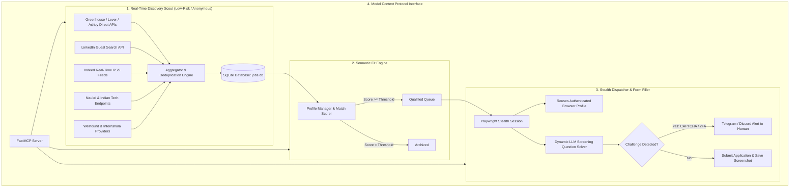

# ⚡ MCP: 24/7 Autonomous Real-Time Job Scout & Application System

> Inspired by the **Model Context Protocol (MCP)**. Built for developers and job seekers to beat the crowd by discovering and applying to newly published jobs within seconds of appearance.

---

## 🎯 The Problem

When a high-quality job posting appears on platforms like LinkedIn, Indeed, Wellfound, or Naukri, it receives **hundreds of applicants within the first few hours**. Human applicants who see the job 1-2 days later are often buried at the bottom of the recruiter's applicant tracking system (ATS).

### Why Naive Application Bots Fail:
1. **Aggressive Bot Detection**: Platforms like LinkedIn and Glassdoor deploy sophisticated fingerprinting (DataDome, Cloudflare) that will permanently ban accounts using basic Selenium/Puppeteer scripts.
2. **Infinite Form Variations**: Every company uses different ATS systems (Greenhouse, Lever, Ashby, Workday, Taleo) with unique custom screening questions ("How many years of experience do you have with Celery?"). Rule-based bots break on step 1.
3. **CAPTCHAs & 2FA**: Blind automation gets blocked by OTPs and CAPTCHAs.

---

## 💡 The Solution: Intelligent MCP Architecture

This project solves these challenges through a three-tier agentic architecture:



---

## ✨ Key Features

- **24/7/365 Continuous Scanning**: Background daemon monitors career platforms on customizable polling intervals (default: 15 minutes).
- **Separation of Discovery & Application**: Discovery runs through public APIs, RSS, and guest search feeds without logging in. Your actual LinkedIn/profile credentials are only invoked when applying.
- **Direct ATS Integration**: Connects straight to public APIs of **Greenhouse**, **Lever**, and **Ashby** (used by OpenAI, Stripe, Figma, Anthropic, Vercel, Supabase) for **instant zero-second latency**.
- **LLM-Powered Screening Solver**: Open-ended screening questions ("Why are you a fit for this role?", "Notice period", "Describe a hard bug") are dynamically answered using your structured candidate knowledge base.
- **Persistent Stealth Browser**: Reuses your real Chrome profile (`data/browser_profile`). You only log in to LinkedIn or Indeed once in that profile; sessions and cookies stay active.
- **Human-In-The-Loop (HITL)**: When a CAPTCHA or 2FA challenge occurs, the system pauses and pings you on **Telegram / Discord** with a sound alert and screenshot, giving you 60 seconds to resolve it in the visible window.
- **Model Context Protocol (MCP) Server**: Integrates with Claude Desktop, Cursor, and Antigravity IDE so you can inspect jobs and trigger applications conversationally.

---

## 📁 Repository Structure

```
d:\MCP/
├── mcp_server/
│   ├── __init__.py
│   └── server.py              # FastMCP Server exposing tools and prompts
├── core/
│   ├── config.py              # Settings and environment loader
│   ├── database.py            # SQLite database with deduplication and tracking
│   ├── models.py              # Pydantic schemas (JobListing, Profile, Status)
│   └── profile_manager.py     # Profile evaluation, matching, and LLM formatting
├── discovery/
│   ├── base.py                # Abstract Base Provider
│   ├── aggregator.py          # Multi-platform coordinator
│   └── providers/
│       ├── ats_direct.py      # Direct Greenhouse & Lever public APIs
│       ├── linkedin.py        # LinkedIn real-time guest search provider
│       ├── indeed.py          # Indeed real-time RSS provider
│       ├── naukri.py          # Naukri & Indian tech jobs provider
│       ├── wellfound.py       # Wellfound startup jobs provider
│       └── internshala.py     # Internshala & early-career jobs provider
├── applicator/
│   ├── browser.py             # Playwright stealth browser with persistent cookies
│   ├── screening_solver.py    # LLM Q&A solver grounded in candidate profile
│   ├── form_filler.py         # Autonomous ATS form filler and screenshot capturer
│   └── hitl.py                # Human-In-The-Loop Telegram/Discord alerting
├── worker/
│   └── scheduler.py           # 24/7 autonomous background daemon
├── config/
│   ├── candidate_profile.json # Your personal info, skills, education, and answers
│   └── search_preferences.json# Multi-role keywords, locations, and thresholds
├── cli.py                     # Rich CLI interface
├── requirements.txt           # Python dependencies
└── README.md
```

---

## 🚀 Quickstart Guide

### 1. Install Dependencies
```bash
# Clone the repository
git clone https://github.com/your-username/mcp-job-agent.git
cd mcp-job-agent

# Create a virtual environment
python -m venv venv
venv\Scripts\activate   # On Windows
# source venv/bin/activate  # On Linux/macOS

# Install requirements
pip install -r requirements.txt

# Install Playwright browser binaries
playwright install chromium
```

### 2. Configure Your Profile & Preferences
1. **Candidate Profile**: Edit `config/candidate_profile.json` with your real name, email, phone, skills, experience, and standard answers (notice period, expected CTC, work authorization). Place your resume at `config/resume.pdf`.
2. **Search Preferences**: Edit `config/search_preferences.json` to specify:
   ```json
   {
     "target_roles": ["Full Stack Engineer", "Python Developer", "AI Engineer"],
     "locations": ["Remote", "Bengaluru", "San Francisco, CA"],
     "max_job_age_hours": 24,
     "match_threshold_percent": 70,
     "auto_apply": false
   }
   ```
3. **Environment**: Copy `.env.example` to `.env`:
   - **Baseline Open-Source Cloud (Recommended)**: Set `LLM_PROVIDER=groq`, `LLM_MODEL=llama-3.3-70b-versatile` with your free Groq API key for 300+ tok/s tool calling.
   - **Baseline Open-Source Local (100% Free & Offline)**: Run `ollama run qwen2.5:14b` (or `qwen2.5:7b`), and set `LLM_PROVIDER=ollama`, `LLM_MODEL=qwen2.5:14b` with zero API keys required.

---

## 🤖 Open-Source Baseline Models for Tool Calling & Orchestration

The system natively supports top-performing open-source weights for agentic multi-step tool calling:
- **`Qwen 2.5 (14B / 32B / 72B Instruct)`**: Outstanding structured JSON tool calling, complex reasoning, and form question answering.
- **`Llama 3.3 (70B Instruct)`**: Built-in tool-calling tokens, lightning-fast on Groq, exceptional reliability for screening answers and cover letters.
- **`DeepSeek-V3 / Chat`**: High performance open-weights reasoning.

## 💻 CLI Commands

### 🔍 Run an Instant Discovery Sweep
```bash
python cli.py scout
```
Polls all enabled platforms right now and displays freshly posted jobs matching your target roles.

### 📋 View Discovered Jobs
```bash
python cli.py list --limit 20
```

### 🧠 Evaluate Job Match
```bash
python cli.py evaluate <job_id>
```
Breaks down the semantic fit between your resume and the job requirements.

### 🤖 Apply to a Job
```bash
# Pre-fill form and review before submitting:
python cli.py apply <job_id>

# Auto-submit immediately:
python cli.py apply <job_id> --auto-submit
```

### 📊 View Analytics Dashboard
```bash
python cli.py stats
```

### 🔄 Run 24/7 Autonomous Daemon
```bash
python cli.py worker
```

### 🌐 Manage Job Platforms (Add New Platforms Dynamically)
```bash
# List all active platforms (built-ins + custom + plugins):
python cli.py platform list

# Add an RSS-based job board (e.g. RemoteOK, WeWorkRemotely):
python cli.py platform add --name "remoteok" --type "rss" --url "https://remoteok.com/remote-jobs.rss"

# Add an API-based job board:
python cli.py platform add --name "jobicy" --type "json_api" --url "https://jobicy.com/api/v2/remote-jobs?count=20&tag={role}"

# Toggle or remove a platform:
python cli.py platform toggle remoteok --disable
python cli.py platform remove remoteok
```

You can also drop custom `.py` scripts into [`discovery/plugins/`](file:///d:/MCP/discovery/plugins) (any subclass of `BaseJobProvider` is auto-discovered at runtime).

---

## 🔌 Using with Model Context Protocol (MCP) Clients

You can connect this agent directly to **Claude Desktop**, **Cursor**, or **Antigravity IDE**!

### Claude Desktop Configuration (`claude_desktop_config.json`):
```json
{
  "mcpServers": {
    "job-agent": {
      "command": "python",
      "args": ["-m", "mcp_server.server"],
      "cwd": "D:\\MCP"
    }
  }
}
```

### Available MCP Tools:
- `search_recent_jobs(roles, platform, min_match_score, trigger_live_crawl)`
- `evaluate_job_fit(job_id)`
- `apply_to_job(job_id, auto_submit)`
- `get_application_status()`
- `get_candidate_profile()`
- `generate_cover_letter_prompt(job_id)`

---

## 🛡️ Best Practices for Staying Safe

1. **Keep `auto_apply: false` initially**: Run in "Review Mode" for the first week. The agent will discover and pre-fill forms, leaving the final "Submit" button for you to review. Once confident, enable `auto_apply: true`.
2. **Log into platforms once**: Launch the browser manually once using `BROWSER_USER_DATA_DIR` so your login cookies are saved.
3. **Set realistic intervals**: Polling every 15 minutes is optimal; it provides immediate discovery while staying under rate-limit radar.

---

## 📜 License
MIT License. Open source and free for individual use.
